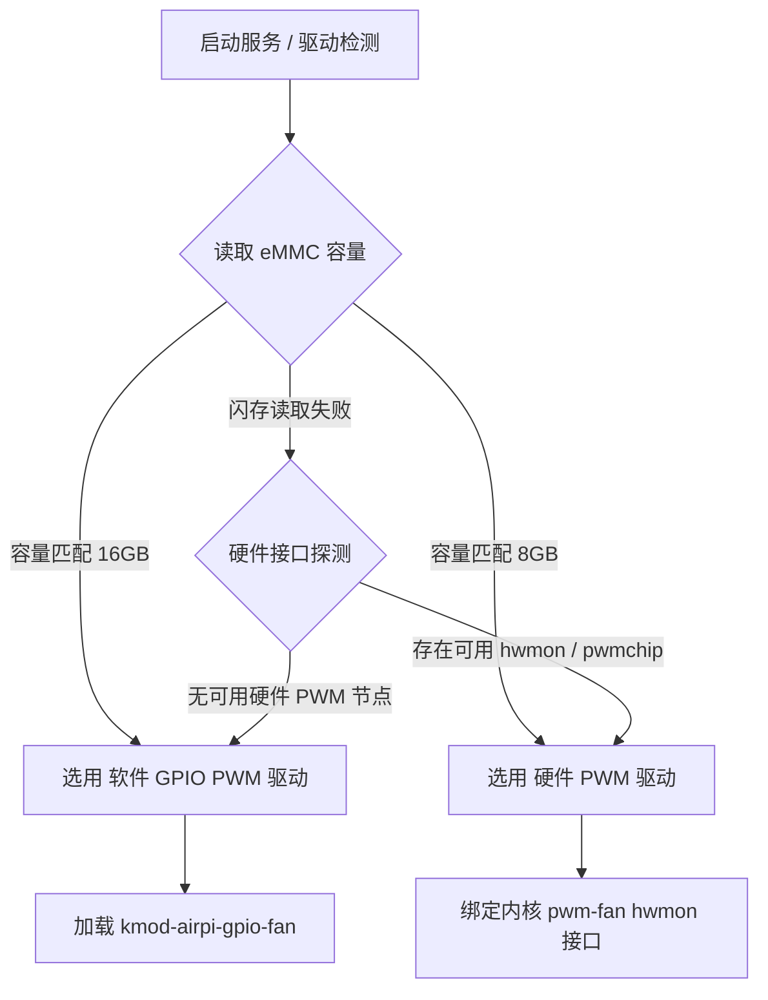

<div align="center">

# 🌀 luci-app-airpi3000m-fancontrol

**专为 Airpi AP3000M 打造的现代风扇控制插件 · LuCI 原生 JS 架构 + Rust 高性能温控守护进程**

[](https://github.com/LianXia233/luci-app-airpi3000m-fancontrol/actions/workflows/build.yml)
[-orange)](#)
[](#)
[-purple)](#)
[-red)](#)
[](LICENSE)

*支持 8G / 16G eMMC 闪存规格自动识别，集成硬件 PWM 与 GPIO 软 PWM 双驱动、多温区仲裁与无极调速*

---

</div>

> [!CAUTION]
> **专机专用硬件说明**：
> 本插件专为 **Airpi AP3000M 5G CPE**（`airpi,ap3000m`）定制开发，底层 GPIO 编号、PWM sysfs 路径与各温区传感器探测链路均严格匹配该设备，**请勿安装至其他路由器设备**。

---

## 📌 核心特性

- 🧠 **闪存驱动自适应识别**：根据 eMMC 容量自动决策驱动链路（`16GB` $\rightarrow$ 软 PWM；`8GB` $\rightarrow$ 硬件 PWM），亦支持 WebUI 手动强制切换。
- 🦀 **Rust 高性能温控守护**：底层由原生静态链接的 Rust 二进制程序 `airpi-fanctl` 驱动，零三方依赖、musl 静态链接，内存占用极低且安全可靠。守护进程在**任何模式(含手动/无级)下常驻**，持续采样、持续上报、持续待命守护。
- 🌡️ **多源温度动态仲裁**：采集 **CPU / Wi-Fi 芯片 / 物理层 PHY / 5G 蜂窝模组** 四路温度，以最高温区实时驱动风扇占空比；Wi-Fi 与模组两路需要外部命令，按独立低频周期采样，其余时间沿用上次读数。
- 📈 **温控曲线可配置**：`85/60/50 → 255/192/128/64` 阶梯的全部阈值与占空比、控制周期、降档迟滞、最小保持时间均已开放为 UCI 选项，出厂默认值与旧版硬编码逐位一致。
- 🛡️ **三层散热保底**：传感器连续失效按 `fail_duty` 兜底（默认满速）；手动/无级档位超过 `temp_crit` 时被温控守护临时接管；服务停止时接口保留 `stop_duty` 而非归零停转。
- 🎛️ **丰富调速档位**：支持静音 (25%)、巡航 (50%)、强冷 (75%)、全速 (100%) 四档快捷预设与 0~255 无级调速，设定值与接口实测回读并列显示。
- 🧭 **五标签页界面 (v7.0.0+)**：运行概览 / 风扇控制 / 温控策略 / 传感器与监控 / 高级设置，切换不重建表单、不触碰硬件；深浅色主题跟随 LuCI 实际配色，移动端单列自适应。
- ⚡ **现代 LuCI 架构 (v4.0+)**：基于 Client-Side JavaScript 现代视图架构，彻底剥离过时的 `luci-compat`，无缝兼容 OpenWrt 24.10、25.12 与 ImmortalWrt master 分支。

---

## 🖥️ 设备规格一览

| 硬件规格 | 详细参数 |
| :--- | :--- |
| **设备型号** | Airpi AP3000M 5G CPE |
| **主控芯片** | MediaTek MT7981B（双核 ARM Cortex-A53 @ 1.3GHz） |
| **OpenWrt 目标平台** | `mediatek/filogic` |
| **架构包格式** | `aarch64_cortex-a53` |
| **内存 / 存储** | 1GB DDR4 / 8GB 或 16GB eMMC |
| **散热系统** | PWM 控制散热风扇（无独立测速 Tach 引脚） |
| **设备树兼容标识** | `airpi,ap3000m`（OpenWrt 25.12+ 已内置原生支持） |

---

## ⚡ 快速安装

前往 [Releases 页面](https://github.com/LianXia233/luci-app-airpi3000m-fancontrol/releases) 下载对应固件版本的安装包：

> [!WARNING]
> **内核模块与固件严格对应，先判断你的固件是否已自带风扇驱动**。
> `kmod-airpi-gpio-fan` 是内核模块，必须与目标固件的内核（版本**和编译配置**）一致才能加载——
> 版本号一致不等于能加载，详见下文「差异根源」。Release 中的 kmod 由 CI 按官方
> OpenWrt 24.10.8 / 25.12.5 / ImmortalWrt 当前快照的内核配置构建并逐项校验。
> **厂商 / 自建固件通常已在镜像内内置该模块**，这类设备执行
> `lsmod | grep airpi_gpio_fan` 有输出时，**只安装 luci-app 即可，不要再安装
> Release 的 kmod**——它会覆盖固件里与你的内核匹配的那一份，覆盖后模块将无法加载。
> 自建固件用户请在编译镜像时直接纳入本仓库的包，不要用 Release 的 kmod 覆盖。

### 方式 A：apk 系统 (OpenWrt 25.12.x / ImmortalWrt master 快照)

```sh
apk add --allow-untrusted ./luci-app-airpi-fancontrol-*.apk ./kmod-airpi-gpio-fan-*.apk

# 清除缓存并重载服务
rm -f /tmp/luci-indexcache*; rm -rf /tmp/luci-modulecache/
/etc/init.d/rpcd reload

```

### 方式 B：ipk 系统 (OpenWrt 24.10.x 及更早)

```sh
opkg install ./luci-app-airpi-fancontrol_*.ipk ./kmod-airpi-gpio-fan_*.ipk

# 清除缓存并重载服务
rm -f /tmp/luci-indexcache*; rm -rf /tmp/luci-modulecache/
/etc/init.d/rpcd reload

```

> [!NOTE]
> 安装完成后刷新浏览器缓存，在后台 **状态 → 风扇控制** 查看运行状态并调整驱动参数（状态座舱与硬件总线配置已合并到同一页面，v6.0.0 起不再有独立的「风扇设置」子菜单）。

---

## 🧭 驱动拓扑与硬件匹配机制

AP3000M 存在两款硬件版本，默认在「自动识别」模式下读取 `/sys/block/mmcblk0/size` 进行自适应配置：



| 硬件规格 | 驱动模式 | 底层接口 / 实现机制 |
| --- | --- | --- |
| **16GB eMMC** | **软件 GPIO PWM** | 主板未引出硬件 PWM 引脚，通过 `kmod-airpi-gpio-fan` 内核模块操作 GPIO 540 进行微秒级位翻转模拟 |
| **8GB eMMC** | **硬件 PWM** | 主板引脚已接入硬件控制器，挂载至内核 `pwm-fan`（hwmon）或 MT7981 导出的 `pwmchip` 节点 |

若需手动干预，可在 **状态 → 风扇控制** 页面下方的「风扇驱动与硬件配置」区覆盖自动判定。选择「软件 PWM (GPIO 软中断高精模块)」后才会展开可进一步配置的软 PWM 参数：

* **风扇 GPIO**：默认 `540`
* **模拟 PWM 周期**：默认 `15000` μs，允许 `256 ~ 1000000` μs。驱动把周期切成 256 个下限 1 μs 的时间片，
  低于 256 μs 会产生每秒上百万次定时器中断并可能占满 CPU，因此该下限在配置校验与热更新路径上都会拦截。
  周期过长易产生电磁啸叫，周期过短会略微增加软中断 CPU 负载。

---

### 实机核验记录（16GB 单元，2026-10-25）

在 AP3000M 16GB（ImmortalWrt SNAPSHOT / 内核 6.18.55 / LuCI 26.295）上只读探测确认：

- 风扇实际由 **GPIO 软 PWM** 驱动：`airpi_gpio_fan` 已加载，`/sys/kernel/duty_cycle` 为当前控制值
- 同一台机器上 **`pwm-fan` hwmon 节点也存在**（`/sys/class/hwmon/hwmon2/pwm1`），但实测恒为 `0`
  而风扇仍在转 —— 说明本机风扇并未接到该通道。此时若强行选择「硬件 PWM」，守护进程会卸载
  软 PWM 模块去写 `pwm1`，风扇可能彻底失控而接口回读仍然"正常"。高级设置页会在这种情况下显式告警
- `/sys/class/pwm/pwmchip0`（MT7981，`npwm=3`）存在，但**没有导出任何 `pwmN` 通道**，
  因此那条以 0..255 语义写入 `duty_cycle` 的回退分支在本机不会被命中；其在其他硬件版本上的
  数值语义（标准契约应为纳秒）仍未验证，代码沿用旧版行为未作改动
- 无 tach 反馈：`/sys/class/hwmon/*/fan*_input` 全部不存在
- 本机 CPU 温度上报负值（`thermal_zone0` 约 -12.7℃），按 1~150℃ 有效性区间被丢弃；
  实际控制基准为最高的网络/射频温度（实测 68℃）
- 无 `iwpriv` 与 `modem_ctrl` ubus 对象（无线接口名为 `phy0-ap0`/`phy1-ap0`），
  这两路温度在本机恒为不可用，可在传感器页停用以免浪费采样开销

---

## 🌡️ 智能温控曲线与多源仲裁

温控守护进程默认每 **8 秒**（`auto_interval`，可调 2–300 秒）采样一次全部温度源，
**自动选取其中的最高温区作为调速基准**；阈值与占空比均为 UCI 可配置项，下表为出厂默认：

### 1. 温控调速阶梯

| 触发条件（最高温度 $T$） | 占空比 | 输出比例 | 档位名称 |
| --- | --- | --- | --- |
| $T > 85^\circ\text{C}$ | `255 / 255` | 100% | 全速 |
| $60^\circ\text{C} < T \le 85^\circ\text{C}$ | `192 / 255` | 75% | 强冷 |
| $50^\circ\text{C} < T \le 60^\circ\text{C}$ | `128 / 255` | 50% | 巡航 |
| $T \le 50^\circ\text{C}$ | `64 / 255` | 25% | 静音 |

升档立即生效；降档需同时满足**迟滞条件**（温度低于阈值减去 `hysteresis`）与**最小保持时间**
（距上次调整不少于 `min_hold` 秒），用以抑制风扇在阈值附近来回抖动。

### 2. 四路温度探测机制

| 温区来源 | 底层采集通道 | 过滤校验机制 |
| --- | --- | :--- |
| **CPU 核心** | `/sys/class/thermal/thermal_zone*/temp`，外加名称含 `cpu`/`thermal`/`soc` 的 hwmon 芯片 | 原始值一律显示；仅落在 $1 \sim 150^\circ\text{C}$ 区间的读数参与仲裁 |
| **Wi-Fi 射频** | 优先 `mt79xx`/`mt76xx` hwmon 的 `temp1_input`（无 fork）；无该节点时回退 `iwpriv <dev> stat` 的 `CurrentTemperature` | 同上；回退路径按 `slow_interval` 低频采样 |
| **网络 PHY** | 其余非风扇、非射频 hwmon 芯片的 `temp1_input`（如 `mdio_bus:*`） | 跨芯片取最高，避免首个命中低估热点 |
| **5G 模组** | `ubus call modem_ctrl info` 提取 `temperature` 字段 | 数值 $< 1000$ 视为摄氏度换算，否则按毫摄氏度换算 |

界面与状态文件对每个来源同时给出 `<src>_mc`（原始值）、`<src>_valid`（是否参与仲裁）、
`<src>_age`（采样时效）与 `<src>_err`（不可用或越界原因），因此**坏读数会被如实显示出来而不是被悄悄丢弃**，
但绝不会参与调速；控制温度始终是"所有有效来源的最大值"。
接口完全缺失与读到 $0^\circ\text{C}$ 也是两件事，前者显示为 `—` 而不是低温。

> [!IMPORTANT]
> 本机（16GB 单元）的 CPU 温度传感器实际上报负值（约 $-12^\circ\text{C}$），属于该内核的已知异常：
> 它仍会显示在概览与传感器页并标注"读数异常，不参与仲裁"，调速基准由 60 ℃+ 的射频温度承担。

> [!NOTE]
> AP3000M 未引出风扇 Hall 测速（tach）引脚，**风扇物理转速无法回读**。界面因此不提供 RPM / dBA / CFM 这类换算值，
> 只并列展示两项真实数据：你设定的目标占空比，以及从 `/sys/kernel/duty_cycle` 或 `pwm-fan` 的 `pwm1`
> 实际读回当前档位；两者不一致时按接口异常告警。

---

## 🖥️ 界面分区（v7.0.0 标签页）

页面入口不变：**状态 → 风扇控制**（`admin/status/airpi-fancontrol`），内部改为五个标签页，
当前页记录在 URL hash（如 `#curve`），刷新或分享链接可直接回到同一页。

| 标签页 | 内容 | 数据来源 |
| --- | --- | --- |
| **运行概览** | 风扇转子动画（周期由真实占空比驱动）、设定占空比与接口实测回读、控制链路状态、生效曲线与档位、温度来源、告警自检、温度/占空比趋势图 | `snapshot`，5 秒轮询 |
| **风扇控制** | 智能温控、四档固定预设、无级滑块（拖动只改预览，需显式应用）、退出自动模式的确认对话框 | `set` / `auto` / `stepless` |
| **温控策略** | 三段阈值与四档占空比、控制周期、降档迟滞、最小保持；随编辑实时绘制阶梯曲线并对非法顺序给出阻止提示 | UCI `airpi-fan` |
| **传感器与监控** | 四路来源的实测值、采样时效、不可用原因与接口路径；来源开关与外部命令采样周期；明确标注本硬件无 tach 反馈 | `snapshot` + UCI |
| **高级设置** | 驱动选择 / GPIO / 周期、安全兜底参数、日志级别与日志尾部读取、硬件拓扑探测、服务状态与配置重载、配置导入导出与恢复出厂 | `hwdetect` / `logs` / `reload` + UCI |

交互与性能要点：

- 标签页切换只做显隐，**不重建表单、不下发任何控制命令、不重发硬件探测**；未保存的编辑内容在切换后保留。
- 全页只有 **一个** 轮询回调，容器离开文档时自行注销；浏览器后台标签不发起请求。
- 硬件探测（`hwdetect`）只在高级设置页可见时按需刷新，日志只在进入该页或点击刷新时读取。
- 每次刷新对设备只有 **1 次** 进程派生（`snapshot` 命中状态文件时无需再调用 `uci`/`iwpriv`/`ubus`）。
- 深浅色由渲染时页面实际背景亮度判定，并同时提供 `prefers-color-scheme` 回退；
  动画遵循 `prefers-reduced-motion`，移动端 ≤640px 自动单列、标签页按钮整行可点。

---

## 🦀 Rust 温控守护进程 (`airpi-fanctl`)

自 v5.0.0 起，核心温控调度由 Rust 编写的独立程序 `/usr/bin/airpi-fanctl` 承载。v7.0.0 重构后的子命令全貌：

```sh
airpi-fanctl daemon              # 温控守护前台主循环（交由 procd 托管，任何模式都常驻不退出）
airpi-fanctl snapshot            # 一次读出整页所需状态（优先回读 /tmp/airpi-fan.state，零额外派生进程）
airpi-fanctl status              # 查看转速、档位码、生效驱动与运行状态（mode= 为机器可读码，mode_cn= 保留中文）
airpi-fanctl temp                # 输出最高温度与对应来源标识
airpi-fanctl temps               # 列出当前所有可用的温度源键值
airpi-fanctl legacy-temp <opt>   # 兼容 get_sys_temp.sh 的旧输出格式（-a/-c/-s）
airpi-fanctl set <0-255> <0-3>   # 固定档位：写模式与占空比，服务缺席时补 start（不再 stop 服务）
airpi-fanctl auto                # 切回智能温控：写档位码 9，运行中的守护进程下一轮生效，不重启服务
airpi-fanctl stepless <0-255>    # 无级调速：写档位码 999 与目标占空比
airpi-fanctl hwdetect            # 打印 eMMC 大小、软硬件驱动与 PWM 路径检测全貌
airpi-fanctl logs [n]            # 读取 /tmp/airpi-fancontrol.log 尾部 n 行（默认 80）
airpi-fanctl reload              # 配置重载提示：运行中无需重启，未运行时拉起服务

```

### 守护进程状态快照

`airpi-fanctl snapshot`（以及其来源 `/tmp/airpi-fan.state`）输出的关键字段：

| 字段 | 含义 |
| --- | --- |
| `mode` / `mode_code` | `auto`/`manual`/`stepless` 与对应 `/etc/fanvall` 档位码 |
| `duty` / `duty_sysfs` / `duty_source` | 目标占空比、接口实测回读、回读来源（`written`/`sysfs`/`unknown`） |
| `temp` / `temp_mc` / `temp_source` / `band` | 主控温度、毫摄氏度原值、热源、当前曲线档位 |
| `cpu_mc` `phy_mc` `wifi_mc` `modem_mc` + `_age` `_err` | 逐来源读数、采样时效与不可用原因（`-1` 表示无有效读数，绝不当作 0 ℃） |
| `alarm` / `alarm_msg` / `guarded` / `misses` | 告警类别（`none`/`sensor`/`thermal`/`config`/`interface`）、说明、守护接管状态、连续失效次数 |
| `policy` / `interval` / `hysteresis` / `min_hold` / `crit_guard` / `fail_duty` | 当前生效的曲线与控制/保底参数 |
| `config_errors` | 被拒绝的配置项及回退说明（不静默采用默认值） |

### 档位控制状态码（写入 `/etc/fanvall`）

| 档位码 | 工作模式 | 行为描述 |
| --- | --- | --- |
| `0` / `1` / `2` / `3` | 固定档位 | 对应占空比 `64` / `128` / `192` / `255`（静音 / 巡航 / 强冷 / 全速） |
| `9` | 智能温控 | 守护进程按温度曲线自动调速 |
| `999` | 无级调速 | 维持用户指定的任意占空比；守护进程常驻但**不覆盖**该值 |

> [!IMPORTANT]
> v7.0.0 起，手动与无级模式**不再停止温控服务**。旧版会先 `/etc/init.d/airpi-fancontrol stop`
> （软 PWM 因此被写 0 停转）再写目标值，且守护进程遇到固定档位会写完一次即退出，被 procd 反复拉起直至放弃。
> 现在守护进程在所有模式下常驻：策略上尊重用户档位，同时保留采样、上报与临界温度接管能力。

---

## ⚙️ 配置文件与服务控制

UCI 配置文件位于 `/etc/config/airpi-fan`（列为 `conffiles`，升级插件时保留用户改动）：

```uci
config fan 'settings'
    option fan_driver 'auto'      # auto (自动) | softpwm (软PWM) | pwm (硬PWM)
    option fan_gpio   '540'       # 软 PWM 使用的 GPIO 编号
    option fan_freq   '15000'     # 模拟周期 (微秒 μs)，保存后热更新内核参数

    # 温控曲线：阈值必须严格递增，占空比必须随温度单调不降
    option temp_high '85'   option duty_high '255'
    option temp_mid  '60'   option duty_mid  '192'
    option temp_low  '50'   option duty_low  '128'
    option duty_idle '64'

    # 控制周期与平滑
    option auto_interval '8'      # 秒，2..300
    option hysteresis    '2'      # ℃，降档迟滞，0..15
    option min_hold      '30'     # 秒，两次降档最小间隔（升温不受限）

    # 安全保底
    option temp_crit '95'         # 超过即由守护接管为满速
    option crit_guard '1'         # 手动/无级模式是否允许接管
    option fail_duty '255'        # 连续取不到有效温度时的兜底档位
    option fail_count '3'         # 判定失效所需的连续轮数
    option stop_duty '64'         # 服务停止后留在接口上的保底占空比

    # 来源与采样频率
    option src_cpu '1'  option src_phy '1'  option src_wifi '1'  option src_modem '1'
    option slow_interval '30'     # iwpriv / ubus 低频采样周期（秒）

    # 诊断：0=关闭 1=仅错误 2=信息 3=调试
    option log_level '2'
```

> [!NOTE]
> 从 6.x 升级上来的设备配置文件里没有这些新选项，守护进程会按上表默认值补齐，**默认行为与旧版逐位一致**；
> 想启用新曲线只需在网页对应标签页改并保存。配置项若越界或顺序非法，守护进程保留原值、回退到出厂阶梯，
> 并把原因写进 `config_errors` 在概览页告警 —— 不会静默用假默认值掩盖故障。

### 服务管理命令

```sh
/etc/init.d/airpi-fancontrol start    # 启动守护进程
/etc/init.d/airpi-fancontrol stop     # 停止服务，接口保留 stop_duty（默认 64）而非归零停转
/etc/init.d/airpi-fancontrol restart  # 重载配置并重启
/etc/init.d/airpi-fancontrol reload   # 保存配置后无需重启：运行中的守护进程下一轮自读
/etc/init.d/airpi-fancontrol enable   # 设置开机自启

```

### 软 PWM 内核模块参数

```sh
# 手动加载内核模块示例
insmod airpi-gpio-fan.ko fangpio=540 cycle=255 period=15000 fanen=1

# 通过 sysfs 直接交互
echo 128 > /sys/kernel/duty_cycle    # 设置 50% 占空比
cat /sys/kernel/duty_cycle          # 读取当前占空比

```

---

## 🛠️ 深度技术解析与避坑指南

自 v4.0.0 起，`kmod-airpi-gpio-fan` 内核驱动采用**源码级自适应**，不再通过内核版本硬编码分支：

1. **GPIO 申请路径自适应**：
* Linux 6.17 引入了 `CONFIG_GPIOLIB_LEGACY`。若关闭该项，传统的 `gpio_request()` / `gpio_free()` 整数接口将不可用。
* 驱动通过 `IS_ENABLED(CONFIG_GPIOLIB_LEGACY)` 探测：开启时走传统整数路径；关闭时自动改走「描述符 + 查找表」路径（由全局 GPIO 编号推导控制器与 offset，经 `gpiod_add_lookup_table()` 绑定到驱动自带 platform device），无需修改设备树。


2. **高精度定时器**：
* 内核 6.15 移除了 `hrtimer_init()`，统一由 `hrtimer_setup()` 取代，源码中已通过预编译宏做平滑过渡。


在 AP3000M 实机（ImmortalWrt / 内核 6.18）上排查发现：**即使 vermagic 完全一致，模块依然可能被内核拒绝加载**，报错：

```text
.gnu.linkonce.this_module section size must match the kernel's built struct module size at run time

```

### 差异根源：Kconfig 配置改变了结构体大小与偏移

| 内核配置项 | 官方 SDK 默认 | 目标固件环境 | 对 struct module 的影响 |
| --- | --- | --- | --- |
| `CONFIG_MODULES_TREE_LOOKUP` | y | n | 结构体大小变化 **-384 字节** |
| `CONFIG_EVENT_TRACING` | y | n | 结构体大小变化 **-64 字节** |
| `CONFIG_DEBUG_INFO_BTF_MODULES` | y | n | 结构体大小变化 **-64 字节** |
| `CONFIG_BPF_EVENTS` | y | n | 总大小看似被对消，但导致 `exit` 字段后移 16 字节！ |

> [!WARNING]
> 最后一项尤其隐蔽：结构体大小总和完全一致，但由于 `mod->exit` 被内核偏移解析为 `NULL`，模块会被强制标为 `[permanent]`，表现为**可加载、可控速，但无法 `rmmod` 卸载**。
> **核验基准命令**：
> ```sh
> readelf -SW airpi-gpio-fan.ko | grep this_module   # 期望 size = 0x2c0 (704)
> readelf -rW airpi-gpio-fan.ko | grep this_module   # 期望恰好 2 个重定位项: 0x138 与 0x298
> 
> ```

### 实机取证：同一份源码、同一个 vermagic，`.ko` 却差 512 字节

2026-10-28 在一台 ImmortalWrt 固件（内核 6.18.55，镜像内置模块）上对
「固件自带的 .ko」与「CI 对着 master SDK 编出的 .ko」做了逐项比对，确认了上述推断：

| 观测量 | 固件自带（可加载） | CI 构建（被拒绝） |
| --- | --- | --- |
| `vermagic` | `6.18.55 SMP mod_unload aarch64` | 完全相同 |
| `.gnu.linkonce.this_module` 区段大小 | `0x2c0`（704） | `0x4c0`（1216） |
| `__this_module` 重定位项数 | 2 | 4 |
| `.BTF` 段 | 无 | 无 |

差异（512 字节 = 0x200，重定位 +2）全部来自**内核编译配置**，与模块源码无关。
固件自带的另一个官方编译模块 `pwm-fan.ko` 的 `this_module` 同为 `0x2c0`，
说明这是该固件内核的统一布局，而非本模块的偶然。

### CI 如何保证 kmod 与官方固件兼容（v7.0.3 起）

SDK 的 `Config.in` 是重新生成的（BUILDBOT 预设），不保证内核符号默认值与官方镜像
构建一致。v7.0.3 起 CI 对每个矩阵目标：

1. **对齐**：下载官方发布目录下的 `config.buildinfo`，把其中 `CONFIG_KERNEL_*`
   段作为覆盖层写进 SDK 的 `.config`（`include/kernel-defaults.mk` 的
   `Kernel/Configure/Default` 会把它剥前缀合并进内核 `.config`），内核即按
   官方固件的配置编译；同时安装 `dwarves`（pahole）以支持 BTF 模块构建
2. **校验**：编译后逐个比对内核 `.config` 与覆盖层，任何符号不符即使作业失败，
   不允许发出加载不上的 `.ko`；构建缓存键纳入覆盖层指纹，配置一变即重编内核
3. **自检**：记录 `.ko` 的 `this_module` 区段大小与重定位数到构建日志，便于比对

> [!IMPORTANT]
> 因此 Release 的 kmod 的可加载范围是：**官方 OpenWrt 24.10.8 / 25.12.5 /
> ImmortalWrt 与 Release 同期或更新的官方快照固件**。快照滚动更新时内核配置
> 可能变化，请使用与固件同期或更新的 Release；厂商 / 自建固件的内核配置
> 无从复现，应继续使用固件自带的模块（或在自己的构建树里更新它）。
> 
> 

---

## 🏗️ 编译指南

### 1. 通过 GitHub Actions 自动化编译

仓库已配置多环境流水线，推送标签即可触发构建：

```sh
git tag v7.0.1
git push origin v7.0.1

```

CI 将针对 **OpenWrt 24.10.x**、**OpenWrt 25.12.x** 以及 **ImmortalWrt master 快照** 同时发起矩阵构建。

流水线按三级缓存复用，命中时无需再跑内核全量编译（原本单个作业约 95 分钟）：

| 缓存 | 内容 | 失效条件 |
| --- | --- | --- |
| `sdk-*` | 解压后的 SDK | SDK 下载地址变化 |
| `feeds-*` | feeds 源码 | 自然周变化 |
| `build-*` | `build_dir/target-*`、`staging_dir/target-*`（含内核编译产物） | SDK 指纹、内核版本或**官方内核配置覆盖层**变化 |

构建前 CI 会下载官方发布目录的 `config.buildinfo` 并把 `CONFIG_KERNEL_*` 段
作为覆盖层写进 SDK 的 `.config`，使内核按官方固件的配置编译；同时裁掉 filogic
目标配置中的 MediaTek 厂商驱动（影响 struct module 布局与 vermagic 的框架
符号全部保留，`.ko` 的 ABI 不变）；编译后逐个符号校验内核 `.config` 与覆盖层
一致，不一致即使作业失败（详见上文「CI 如何保证 kmod 与官方固件兼容」）。

构建前会执行 `tools/patch-libffi.py`，修补部分 SDK 树（如 ImmortalWrt master）里 libffi 3.4.7
`fficonfig.h` 的 staging 缺陷——该缺陷会让依赖闭包中的 libffi 在 `cannot stat` 处中断整个作业。
脚本幂等，对本就没有该问题的树不做任何改动。

### 本地开发校验

```sh
# 后端：单元测试与静态检查（宿主机即可跑，纯函数不依赖 /sys）
cd luci-app-airpi-fancontrol/src && cargo test && cargo clippy --all-targets

# 前端：语法检查（需 node）
node --check luci-app-airpi-fancontrol/htdocs/luci-static/resources/view/airpi-fancontrol/fancontrol.js

# 实机只读探测（不改任何设备状态）
sh tools/airpi-probe.sh                # 在设备上直接执行
ssh root@192.168.10.1 'sh -s' < tools/airpi-probe.sh   # 经 SSH 管道执行
```

### 2. 本地 SDK 编译

```sh
# 准备目标 SDK 并更新 feeds
./scripts/feeds update -a && ./scripts/feeds install -a

# 引入项目源码
git clone [https://github.com/LianXia233/luci-app-airpi3000m-fancontrol.git](https://github.com/LianXia233/luci-app-airpi3000m-fancontrol.git) /tmp/airpi
ln -s /tmp/airpi/luci-app-airpi-fancontrol package/luci-app-airpi-fancontrol
ln -s /tmp/airpi/airpi-gpio-fan            package/airpi-gpio-fan

# 配置目标包并执行编译
make defconfig
echo 'CONFIG_PACKAGE_luci-app-airpi-fancontrol=m' >> .config
echo 'CONFIG_PACKAGE_kmod-airpi-gpio-fan=m'       >> .config
make package/luci-app-airpi-fancontrol/compile V=s
make package/airpi-gpio-fan/compile V=s

```

> [!TIP]
> **跳过 SDK 内部 Rust 构建**：若已在宿主机使用 cargo 交叉编译好了 `airpi-fanctl`，可追加参数 `AIRPI_PREBUILT=1 AIRPI_PREBUILT_BIN=/path/to/airpi-fanctl` 快速打包。

---

## 📂 项目结构

```text
.
├── .github/workflows/build.yml        # CI 自动编译与发版工作流
├── airpi-gpio-fan/                    # GPIO 软 PWM 内核驱动
│   ├── Makefile                       # OpenWrt kmod 打包脚本
│   └── src/
│       ├── Makefile                   # Kbuild 定义
│       └── airpi-gpio-fan.c           # 驱动核心源码
├── luci-app-airpi-fancontrol/         # LuCI 现代前端与后端
│   ├── Makefile                       # OpenWrt package 构建规则（v7.0.0）
│   ├── src/                           # Rust 守护进程工程
│   │   ├── Cargo.toml                 # 零三方依赖 Cargo 配置
│   │   ├── Cargo.lock
│   │   └── src/main.rs                # 采样→策略→执行→上报四段式主循环 + 19 项单元测试
│   ├── htdocs/luci-static/resources/view/airpi-fancontrol/
│   │   └── fancontrol.js              # 五标签页视图（概览/控制/策略/传感器/高级）
│   └── files/                         # 系统运行资产
│       ├── etc/config/airpi-fan       # 默认 UCI 配置（含曲线、迟滞、安全保底、来源开关）
│       ├── etc/init.d/airpi-fancontrol# procd 启动脚本（停止保留 stop_duty，reload 不中断散热）
│       ├── usr/bin/airpi-fanctl.sh    # rpcd/LuCI 桥接入口脚本
│       ├── usr/bin/get_sys_temp.sh    # 旧温度脚本兼容包装
│       └── usr/share/{luci/menu.d,rpcd/acl.d}/  # 菜单注册与最小权限 ACL
├── tools/
│   ├── airpi-probe.sh                 # 实机只读探测脚本（13 段，不改任何设备状态）
│   └── patch-libffi.py                # CI 用：修补 SDK libffi 的 fficonfig.h staging 缺陷
├── docs/                              # 界面预览资源
├── CHANGELOG.md                       # 版本迭代历史
└── LICENSE                            # GPL-2.0 开源授权

```

---

## 💖 致谢与开源协议

* 本项目基于 **Manper** 大佬的初始工作重构演进，在此基础之上完成了针对 AirPi AP3000M 的软硬件双模式适配、内核兼容性升级与 Rust 核心重构。
* 感谢开源社区所有无私奉献的开发者。
* 本项目遵循 [GPL-2.0-only](https://www.google.com/search?q=LICENSE&utm_source=gemini) 开源协议发布。
